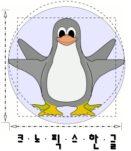

# [Knoppix 한글 프로젝트 홈 페이지](http://knoppixko.kldp.net/)

* kldp.net이 폐쇄되면서 프로젝트 페이지가 사라진 상태입니다.
* 추후 knoppix 한글화에 쓰인 스크립트를 github에 올릴 예정입니다.

# Knoppix 한글 이미지 내려받기

Knoppix 한글 이미지를 내려받을 수 있는 링크입니다.

**KFUG에서 무료로 호스팅해주고 있습니다. 최준호님 고맙습니다.**

* [Knoppix 3.8.1 한글 이미지 공개](http://bbs.kldp.org/viewtopic.php?t=55146)
  * ~~다운로드~~
  * [스크린샷](http://bbs.kldp.org/viewtopic.php?t=55070)
* [Knoppix 3.8.2 한글 이미지 공개](http://bbs.kldp.org/viewtopic.php?t=57030)
  * ~~다운로드~~
* [Knoppix 4.0.2 한글 릴리즈!!](http://bbs.kldp.org/viewtopic.php?p=310532)
  * [다운로드](https://ftp.kr.freebsd.org/pub/knoppixko/Knoppix-V4.0.2-2005.12.08-KO.iso)
* [Knoppix 5.0.1 한글을 배포합니다.](http://kldp.org/node/72387)
  * [다운로드](https://ftp.kr.freebsd.org/pub/knoppixko/Knoppix-V5.0.1-2006.08.01-KO.iso)
* [크노픽스 한글 5.1을 배포합니다.](http://kldp.org/node/90522)
  * [다운로드](https://ftp.kr.freebsd.org/pub/knoppixko/KnoppixKo-V5.1-2008.01.26.iso)

## 한글화 스크린샷

크노픽스 한글 프로젝트는 라이브 리눅스 배포판인 Knoppix의 데스크톱 환경과 설정 도구를 한국어 사용자가 이용할 수 있도록 한글화한 작업입니다. 아래는 당시 배포한 버전의 실제 화면입니다.

### Knoppix 5.0.1 한글 베타 1

**바탕화면** — 크노픽스 5.0.1 한글 베타 1의 데스크톱 화면입니다.

  

    
    
<strong>NTFS 파티션 접근</strong> — FUSE를 이용해 NTFS 파티션을 읽고 쓰는 기능을 사용했습니다. 당시 NTFS 쓰기 기능에는 데이터 손상 위험이 있어 주의가 필요했습니다.

  

  

    
    
<strong>설정 도구 한글화</strong> — 네트워크 설정과 환경 저장 등 Knoppix 도구(스크립트)의 대화상자를 한국어로 번역했습니다.

  

### Knoppix 5.1 한글

  

    
    
<strong>바탕화면</strong> — Knoppix 개발자 Klaus Knopper가 여행 중 직접 촬영한 노르웨이 Magdalenenfjord의 사진을 배경으로 사용한 화면입니다.

  

  

    
    
<strong>한글화 적용 화면</strong> — 웹 브라우저와 설정 도구를 함께 실행한 모습으로, 한국어 인터페이스가 적용된 데스크톱 환경을 확인할 수 있습니다.

  

