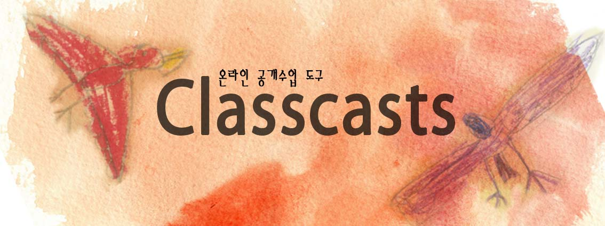
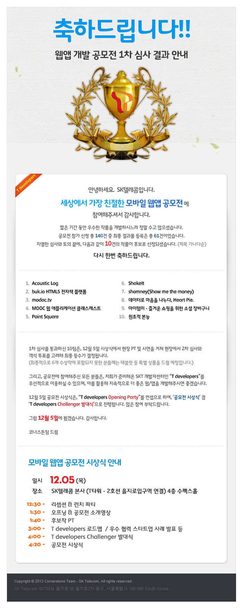

**클래스캐스트(ClassCasts)**는 교사가 수업 영상을 등록하고 확인 문제와 게시판을 운영할 수 있도록 개발한 **Ruby on Rails 기반 온라인 수업 도구**입니다. 영상 콘텐츠를 중심으로 학습 자료를 제공하는 MOOC에서 아이디어를 얻었습니다.

**쑥쑥오름교실**은 클래스캐스트를 이용해 만든 **초등 과학 수업 웹사이트**입니다. 아래 스크린샷은 클래스캐스트를 쑥쑥오름교실에 실제 적용한 모습을 보여줍니다.

## 프로젝트 페이지

* [프로젝트 페이지](https://github.com/ShinJaehun/ClassCasts)

## 관련 영상

### 클래스캐스트 사용법

교사가 수업 영상을 등록하고 학습 자료를 관리하는 사용 흐름을 소개합니다.

<iframe src="https://www.youtube-nocookie.com/embed/NYYLZJu8SL8" title="클래스캐스트 사용법" style="display:block;width:100%;aspect-ratio:16/9;border:0;" loading="lazy" allow="accelerometer; autoplay; clipboard-write; encrypted-media; gyroscope; picture-in-picture; web-share" allowfullscreen></iframe>

[YouTube에서 클래스캐스트 사용법 보기](https://youtu.be/NYYLZJu8SL8)

### 리눅스 시스템 설치 방법

클래스캐스트를 당시 리눅스 환경에 설치하는 과정을 기록한 영상입니다. 오래된 개발 환경을 기준으로 하므로 현재 시스템에 그대로 적용하기보다는 개발 기록으로 참고해 주세요.

<iframe src="https://www.youtube-nocookie.com/embed/HUqrwH--ltM" title="클래스캐스트 리눅스 시스템 설치 방법" style="display:block;width:100%;aspect-ratio:16/9;border:0;" loading="lazy" allow="accelerometer; autoplay; clipboard-write; encrypted-media; gyroscope; picture-in-picture; web-share" allowfullscreen></iframe>

[YouTube에서 리눅스 설치 방법 보기](https://youtu.be/HUqrwH--ltM)

### 실제 과학 수업 콘텐츠

쑥쑥오름교실에서 사용한 과학 수업 영상의 사례입니다.

<iframe src="https://www.youtube-nocookie.com/embed/5HXXk5H-hCs" title="쑥쑥오름교실 과학 수업 콘텐츠" style="display:block;width:100%;aspect-ratio:16/9;border:0;" loading="lazy" allow="accelerometer; autoplay; clipboard-write; encrypted-media; gyroscope; picture-in-picture; web-share" allowfullscreen></iframe>

[YouTube에서 과학 수업 콘텐츠 보기](https://youtu.be/5HXXk5H-hCs)

## 쑥쑥오름교실 주요 화면

  

    
    
<strong>1. 홈 화면</strong> — 학년별 수업 영상 목록과 공지사항을 확인하는 화면입니다.

  

  

    
    
<strong>2. 수업 영상 등록</strong> — 교사가 학년·학기, 단원, 주제와 YouTube 영상 주소를 입력해 수업 자료를 등록합니다.

  

  

    
    
<strong>3. 과학 수업 영상</strong> — 등록한 과학 영상을 학년별로 찾아볼 수 있고, 관리자는 영상 정보를 수정하거나 삭제할 수 있습니다.

  

  

    
    
<strong>4. 확인 문제</strong> — 교사가 만든 과학 문항과 선택지, 정답 및 해설을 보여주는 화면입니다.

  

## 모바일 화면과 초기 설계

  

    
    
<strong>5. 모바일 화면</strong> — 스마트폰에서 로그인, 메뉴, 수업 영상, 확인 문제와 게시판을 이용하는 모습입니다.

  

  

    
    
<strong>6. 초기 아이디어 스케치</strong> — 로그인, 수업 영상 등록, 확인 문제와 과제 화면을 구상한 설계 메모입니다.

  

## 개발 기록

클래스캐스트는 2013년 무렵 수업 동영상을 학생들과 공유하고, 학습한 내용을 확인할 수 있는 온라인 공간을 직접 만들기 위해 시작한 프로젝트입니다. Ruby on Rails와 SQLite를 이용해 개발했으며, YouTube에 올린 영상을 학년·학기·단원별로 연결하는 방식을 사용했습니다.

구체적인 설치 과정과 초기 운영 방법은 [GitHub README](https://github.com/ShinJaehun/ClassCasts#readme)에 남겨 두었습니다.

## 저작권

* 클래스캐스트는 GNU/GPL을 따릅니다.
* 클래스캐스트 사용 과정에서 발생하는 문제에 대해 보증하지 않습니다.

## 수상경력

* SK텔레콤 2013 모바일웹앱공모전 장려상 수상(2013. 12. 5.)

