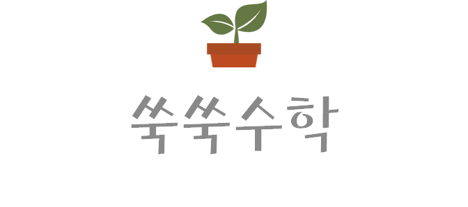
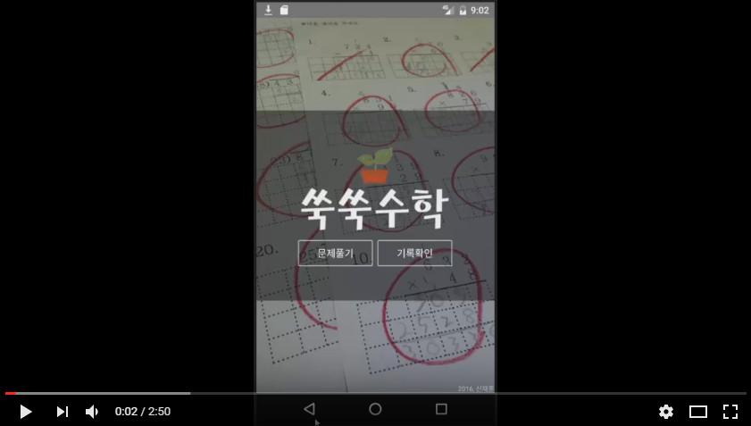

쑥쑥수학은 초등학생이 **곱셈과 나눗셈의 계산 과정을 한 단계씩 직접 연습**할 수 있도록 만든 안드로이드 앱입니다. 정답만 고르는 대신, 세로셈의 중간 계산을 차례대로 완성하며 계산 원리를 익히도록 구성했습니다.

## 프로젝트 페이지

* [기존 GitHub 저장소](https://github.com/ShinJaehun/SukSuk)
* [리뉴얼 GitHub 저장소](https://github.com/ShinJaehun/suksuk_math)
* [앱 설치하기](https://play.google.com/store/apps/details?id=com.shinjaehun.suksuk) : 플레이스토어에서 '쑥쑥수학'이라고 검색해도 됩니다.

## 시연 영상

## 시작 및 연습 유형 선택

  

    
    
<strong>시작 화면</strong> — 문제풀기 버튼으로 연습을 시작합니다.

  

  

    
    
<strong>유형 선택</strong> — 곱셈·나눗셈의 자릿수별 연습이나 도전 문제를 선택합니다.

  

## 곱셈 연습

  

    
    
<strong>계산 과정</strong> — 세로셈의 빈칸을 숫자 버튼으로 채우며 곱셈을 진행합니다.

  

  

    
    
<strong>풀이 완료</strong> — 계산을 끝내면 칭찬 화면으로 성취감을 느낄 수 있습니다.

  

## 나눗셈 연습

  

    
    
<strong>계산 과정</strong> — 몫과 중간 계산을 순서대로 입력하며 나눗셈을 연습합니다.

  

  

    
    
<strong>풀이 완료</strong> — 몫과 나머지까지 계산을 마치면 결과를 확인합니다.

  

## 도전 문제풀기

도전 문제에서는 계산 과정에 제시된 빈칸을 채우며 곱셈과 나눗셈을 응용해 봅니다.

## 태블릿 화면

  

    
    
<strong>연습 선택</strong> — 태블릿의 넓은 화면에서 유형을 선택할 수 있습니다.

  

  

    
    
<strong>문제 풀이</strong> — 왼쪽에 계산 과정, 오른쪽에 숫자 입력 버튼을 배치했습니다.

  

## 개발 및 리뉴얼

기존 버전은 Java와 XML 레이아웃을 중심으로 구현했습니다. 리뉴얼 버전은 **Kotlin과 Jetpack Compose**를 사용하고, 계산 로직과 화면 상태를 분리해 유지보수하기 쉬운 구조로 개선했습니다. 구체적인 설계와 구현 내용은 [리뉴얼 저장소 README](https://github.com/ShinJaehun/suksuk_math#readme)에 정리했습니다.

## 저작권

* 쑥쑥수학은 신재훈이 만들었습니다.
* 쑥쑥수학은 GNU/GPL을 따릅니다.
