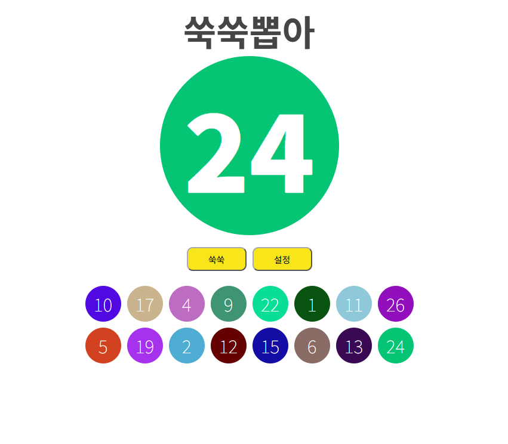
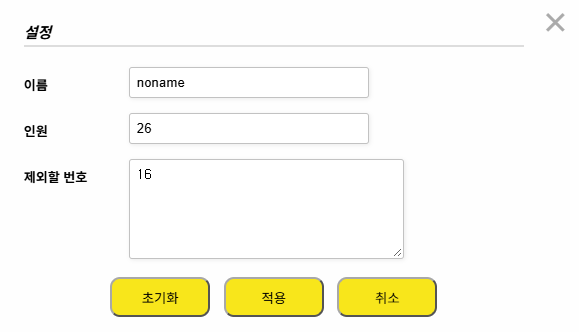

쑥쑥뽑아는 수업 중 발표할 학생을 뽑거나 활동 순서를 정하기 위해 만든  **브라우저 기반 번호 추첨 도구**입니다. 별도의 설치나 로그인 없이 브라우저에서 바로 사용할 수 있습니다.

## 프로젝트 페이지

* [GitHub 저장소](https://github.com/ShinJaehun/suksuk_picker)

## 번호 뽑기

버튼을 눌러 번호 추첨을 시작하고 번호를 확정합니다. 이미 뽑힌 번호는 화면 아래에 표시되며 중복해서 뽑히지 않습니다.

뽑힌 번호를 클릭하면 해당 번호를 다시 추첨 대상으로 되돌릴 수 있습니다.

## 설정

설정 창에서 이름, 전체 인원, 추첨에서 제외할 번호를 지정할 수 있습니다. 설정 적용과 초기화 기능도 제공합니다.

## 개발 현황

학생들에게 보여주는 추첨 화면과 교사용 관리 화면을 분리하여, 교사가 다음에 뽑힐 번호를 미리 지정할 수 있도록 구현했습니다. 현재는 두 화면의 역할을 명확히 하고 사용성을 개선하는 작업을 진행하고 있습니다.

## 저작권

* 쑥쑥뽑아는 신재훈이 만들고 있습니다.
* 쑥쑥뽑아는 GNU GPL을 따릅니다.
